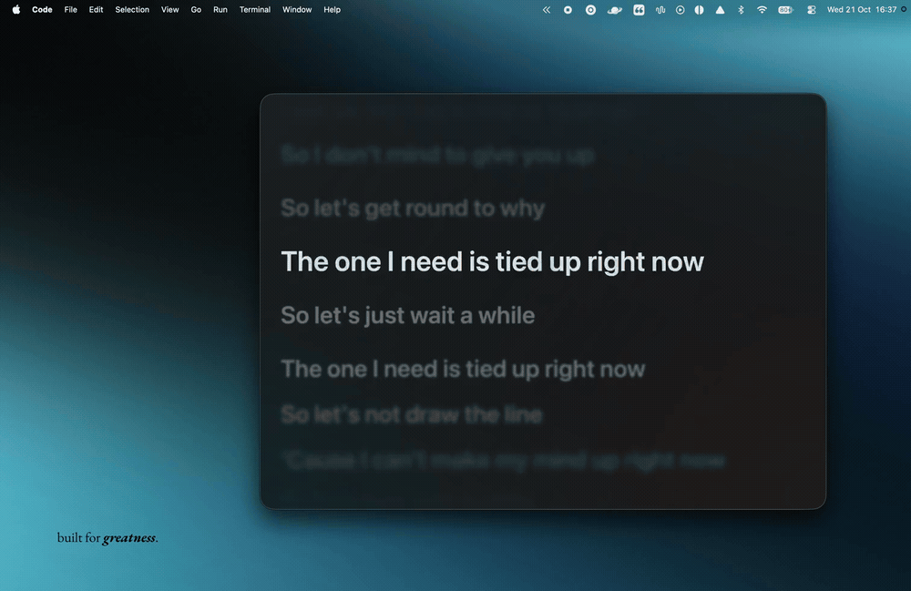

# Overlyric

Resizable Spotify lyrics overlay for macOS.

[](https://github.com/rishi4x/overlyric/blob/main/docs/demo.mp4)

[Watch the video](https://github.com/rishi4x/overlyric/blob/main/docs/demo.mp4) · [Download](https://github.com/rishi4x/overlyric/releases/latest)

## Install

Requires macOS 15 or later and the Spotify desktop app. Supports Apple Silicon and Intel Macs.

1. Download the ZIP from [Releases](https://github.com/rishi4x/overlyric/releases/latest) and extract it.
2. Move **Overlyric.app** to **Applications**, then open it.
3. Allow access to Spotify when macOS asks. Use the menu bar icon to show lyrics.

The app has no Developer ID signature and is not notarized. If macOS blocks it, try opening it once, then go to **System Settings → Privacy & Security → Open Anyway**. [Apple’s instructions](https://support.apple.com/en-us/102445).

Alternatively, if you trust this download, remove its quarantine flag in Terminal, then open it again:

```sh
xattr -dr com.apple.quarantine /Applications/Overlyric.app
```

## Use

- Show lyrics in a floating overlay, in the menu bar, or only alongside Spotify.
- Click a lyric to seek. Scroll to browse, then click **Follow lyrics** to resume.
- Hover for playback controls. Use **⋯** for appearance, lyric timing, search, and reloading.
- **⋯ → Start at login** launches the app when you sign in to your Mac. Off by default.
- Lyrics come from LRCLIB, with NetEase as fallback. Both are queried concurrently; LRCLIB is preferred. No account sign-in is needed.

With the lyrics panel focused:

| Shortcut | Action |
| --- | --- |
| Space | Play or pause |
| ← / → | Back or forward 10 seconds |
| Option–← / Option–→ | Advance or delay lyrics by 0.5 seconds |
| Command–+ / Command–− | Increase or decrease lyric size |
| Command–0 | Reset lyric size |

Settings, recording choices, and song timing save locally. Lyrics cache for 30 days, up to 1,000 songs or 20 MB, evicting the least recently accessed first. **Reload lyrics** requests fresh lyrics.

## Build

Requires Xcode and its command-line tools.

```sh
bash scripts/build.sh
bash scripts/package-release.sh
swift test --disable-sandbox
```

The app and release ZIP are written to `dist/`. Builds use no developer certificate; Apple Silicon executables retain the build tools’ anonymous ad hoc signature.
